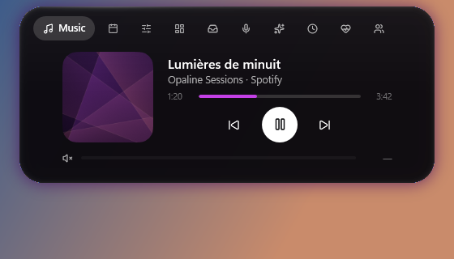
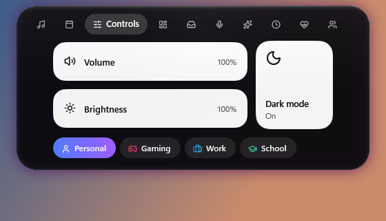
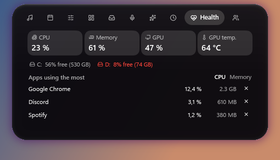
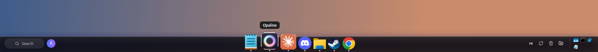
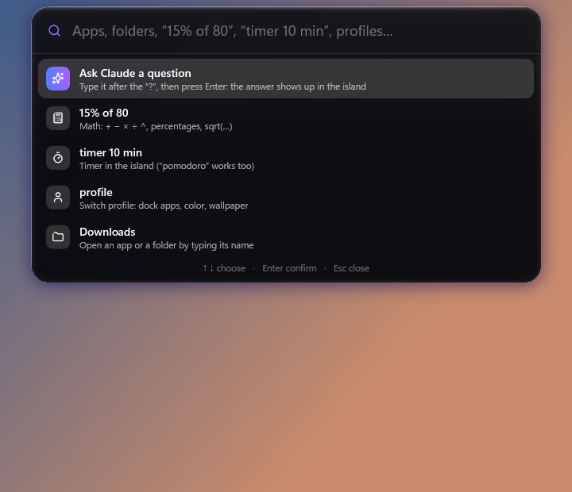
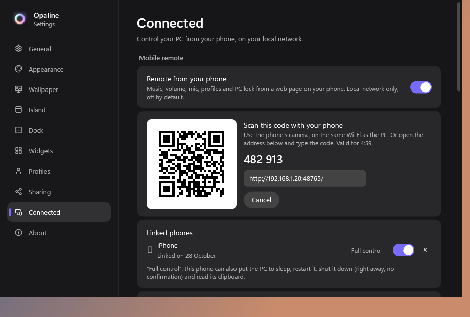

# Opaline for Windows

[Français](README.md) · **English**

An opal-glass island at the top of your screen, a macOS-style dock, a remote control on your phone, desktop widgets and
lots of little tools around them. For Windows 10 (2004+) and Windows 11, 64-bit. In English and French.
Free and **open source** (MIT license): all the code is in this repository.

## Install

1. Download **`Opaline-Setup.exe`** from the [latest release](../../releases/latest).
2. *(recommended)* Check the file: see [Is it safe?](#is-it-safe) below.
3. Run it. Windows may show "Windows protected your PC" (the installer isn't signed, see below): click **More info**
   then **Run anyway**.
4. No administrator rights and no .NET install needed: everything is included.

On first launch, a short wizard helps you pick your profile, colour, wallpaper and what to show. Everything can be changed
later in the settings (click the Opaline icon next to the clock).

Opaline then updates itself: a new version is announced in the island and is only installed if you click "Install" (the
downloaded file is checked against its SHA-256 fingerprint before it runs).

## Uninstall

Windows Settings → Apps → **Opaline** → Uninstall. Windows goes back to how it was before the app: taskbar, wallpaper,
accent colour, light / dark theme, cursor and the remote control's firewall rule. The uninstaller then asks whether you
also want to delete your settings.

## What it does

  
  

- **The island**: clock, music (artwork, equalizer, volume of the playing app), calendar and timer / Pomodoro, controls
  (volume, brightness, dark mode, profiles), widgets (weather, CPU, RAM, GPU, network), file shelf, webcam / mic dots,
  world clocks, PC health, friends online, seasonal themes.
- **The dock**: magnification on hover, window previews, app folders, tray icons, search, macOS-style minimize, status
  area (keyboard language, Windows updates, recycle bin, downloads).
- **Remote control on your phone**: music, volume, mic and headset, launch your apps, send photos to the PC, touchpad,
  keyboard, screen preview, sleep / restart / shut down.
- **Command palette** (Ctrl + Space): apps, folders, maths, timer, profiles, mini Claude.
- **Design**: liquid glass, colours taken from your wallpaper, light / dark theme at sunrise and sunset, wallpapers drawn
  by the app, animated wallpaper, desktop widgets, menu bar, matching cursor.
- **Profiles** (Personal, Gaming, Work, Study…), automatic **Gaming mode**, **RGB lighting** (G HUB, OpenRGB),
  **`.opaline` themes** to share.

  
  

## Is it safe?

- **The code is public**: anyone can read exactly what the app does (the [`src`](src) folder).
- **Check the installer before running it**: every release publishes the **SHA-256** fingerprint of `Opaline-Setup.exe`
  (in the release notes, in the `Opaline-Setup.exe.sha256` file, and next to the file on GitHub).
  1. In the folder of the downloaded file, open PowerShell and type `Get-FileHash .\Opaline-Setup.exe`: the fingerprint
     shown must be **exactly** the same as the release's.
  2. Open the **VirusTotal** link from the release notes (or go to [virustotal.com](https://www.virustotal.com) and drop
     the file there): about 70 antivirus engines scan it. 0 or 1 "generic" detection on an unsigned file is common (false
     positive); several named detections = don't install it and let me know.
- **Why Windows warns you**: the installer isn't signed (a certificate costs money every year, and even when signed,
  Windows keeps warning until many people have downloaded the file). The warning only means "unknown publisher", not
  "virus".
- **What the app never does**: no injection into other programs, no continuous keyboard reading, no ads, no tracking. It
  follows open windows (for the dock) with the official Windows API and only uses administrator rights for 2 things,
  always after you confirm in the Windows prompt: the remote control's firewall rule, and preparing wake-on-LAN.
- **Everything is reversible**: whatever changes Windows (wallpaper, accent colour, theme, cursor, taskbar, firewall,
  network card) is off by default, asks for your consent and goes back to how it was (by unticking it, with "Restore",
  or by uninstalling). If the app closes or crashes, the taskbar always comes back.
- **What is sent over the Internet**, and nothing else:
  - the weather and world-clock city search (Open-Meteo);
  - the update check (GitHub);
  - if you turn them on: Discord (who's talking in your voice channel), your presence on the friends server, your
    questions to mini Claude (to Anthropic, only when you ask one).
- **Remote control**: off by default, only on your "Private" local network, paired with a one-time code; "Full control"
  (mouse, keyboard, screen, shutdown) is turned on phone by phone.

## If something goes wrong

- **Safe mode**: hold **Shift** while starting Opaline (default settings, options off).
- Settings → About → **Export a bug report** (no personal data): send it to Louis.
- Settings are backed up automatically: Settings → About → go back to a previous version.
- If one part of the app crashes, it stops by itself and the rest keeps going.

## Build it yourself

- [.NET 10 SDK](https://dotnet.microsoft.com/download) on Windows 10/11: `dotnet build src/DynamicIsland` then run
  `src/DynamicIsland/bin/Debug/net10.0-windows10.0.22621.0/DynamicIsland.exe`.
- Installer: [Inno Setup 6](https://jrsoftware.org/isinfo.php) then `powershell -File installer\build.ps1` →
  `artifacts\Opaline-Setup.exe` (+ its SHA-256 fingerprint).
- Files and registry keep the original "DynamicIsland" name (the app was called that before Opaline). The code comments
  are in French.

## License

[MIT](LICENSE) © 2026 Louis. Components by other authors: see [THIRD-PARTY-NOTICES.md](THIRD-PARTY-NOTICES.md).
