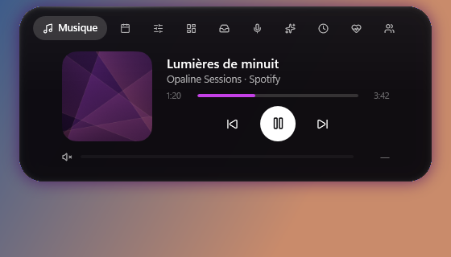
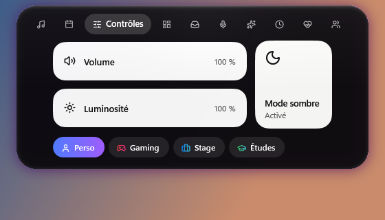
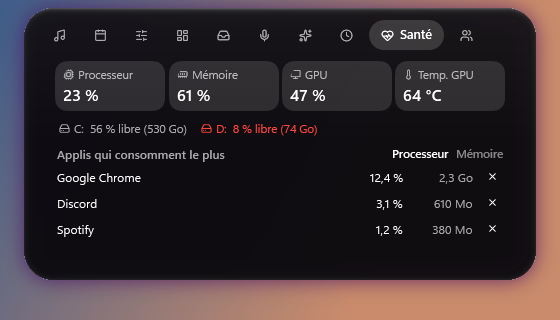
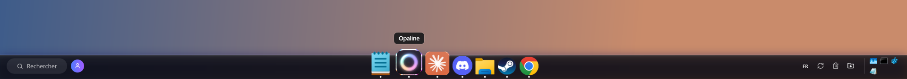
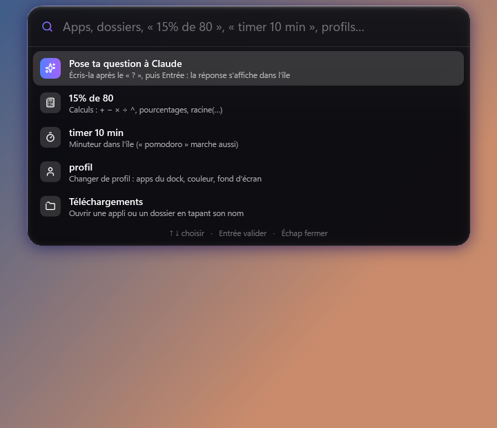
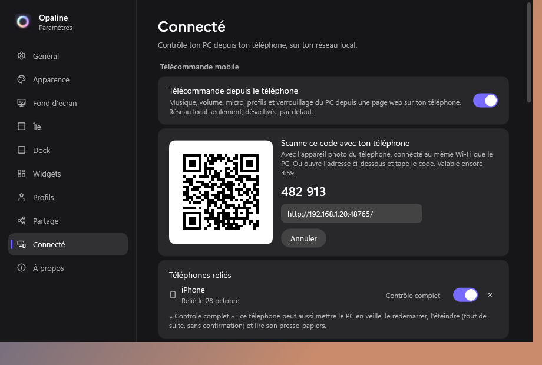

# Opaline pour Windows

**Français** · [English](README.en.md)

Une île en verre d'opale en haut de l'écran, un dock façon macOS, une télécommande sur ton téléphone, des widgets sur le
bureau et plein de petits outils autour. Pour Windows 10 (2004+) et Windows 11, 64 bits. En français et en anglais.
Gratuite et **open source** (licence MIT) : tout le code est dans ce dépôt.

## Installer

1. Télécharge **`Opaline-Setup.exe`** dans la [dernière version](../../releases/latest).
2. *(conseillé)* Vérifie le fichier : voir [Est-ce que c'est sûr ?](#est-ce-que-cest-sûr-) plus bas.
3. Lance-le. Windows peut afficher « Windows a protégé votre ordinateur » (l'installeur n'est pas signé, voir plus bas) :
   clique **Informations complémentaires** puis **Exécuter quand même**.
4. Pas besoin de droits administrateur ni d'installer .NET : tout est inclus.

Au premier lancement, un petit assistant t'aide à choisir ton profil, ta couleur, ton fond d'écran et ce que tu veux
afficher. Tout se change ensuite dans les paramètres (clic sur l'icône Opaline près de l'heure).

Opaline se met ensuite à jour toute seule : une nouvelle version s'annonce dans l'île, et elle ne s'installe que si tu
cliques « Installer » (le fichier téléchargé est vérifié par son empreinte SHA-256 avant d'être lancé).

## Désinstaller

Paramètres Windows → Applications → **Opaline** → Désinstaller. Windows revient comme avant l'app : barre des tâches, fond
d'écran, couleur d'accent, thème clair / sombre, curseur et règle du pare-feu de la télécommande. L'assistant de
désinstallation te demande ensuite si tu veux aussi effacer tes réglages.

## Ce qu'elle fait

  
  

- **L'île** : heure, musique (pochette, égaliseur, volume de l'appli qui joue), calendrier et minuteur / Pomodoro,
  contrôles (volume, luminosité, mode sombre, profils), widgets (météo, CPU, RAM, GPU, réseau), étagère à fichiers,
  points webcam / micro, horloges du monde, santé du PC, amis en ligne, thèmes saisonniers.
- **Le dock** : grossissement au survol, aperçus des fenêtres, dossiers d'applis, icônes d'arrière-plan, recherche,
  réduction des fenêtres façon macOS, zone d'état (langue du clavier, mises à jour Windows, corbeille, téléchargements).
- **Télécommande sur ton téléphone** : musique, volume, micro et casque, lancer tes applis, envoyer des photos vers le PC,
  pavé tactile, clavier, aperçu de l'écran, veille / redémarrer / éteindre.
- **Palette de commandes** (Ctrl + Espace) : applis, dossiers, calculs, minuteur, profils, mini Claude.
- **Design** : verre liquide, couleurs tirées du fond d'écran, thème clair / sombre au lever et au coucher du soleil,
  fonds d'écran dessinés par l'app, fond animé, widgets du bureau, barre de menus, curseur assorti.
- **Profils** (Perso, Gaming, Stage, Études…), **mode Gaming** automatique, **éclairage RGB** (G HUB, OpenRGB),
  **thèmes `.opaline`** à s'échanger.

  
  

## Est-ce que c'est sûr ?

- **Le code est public** : n'importe qui peut lire exactement ce que fait l'app (dossier [`src`](src)).
- **Vérifier l'installeur avant de le lancer** : chaque version publie l'empreinte **SHA-256** de `Opaline-Setup.exe`
  (dans les notes de la version, dans le fichier `Opaline-Setup.exe.sha256`, et à côté du fichier sur GitHub).
  1. Dans le dossier du fichier téléchargé, ouvre PowerShell et tape `Get-FileHash .\Opaline-Setup.exe` : l'empreinte
     affichée doit être **exactement** la même que celle de la version.
  2. Ouvre le lien **VirusTotal** des notes de la version (ou va sur [virustotal.com](https://www.virustotal.com) et
     dépose le fichier) : il est analysé par environ 70 antivirus. 0 ou 1 détection « générique » sur un fichier non
     signé est courant (fausse alerte) ; plusieurs détections nommées = ne l'installe pas et préviens-moi.
- **Pourquoi Windows avertit** : l'installeur n'est pas signé (un certificat coûte de l'argent chaque année, et même
  signé, Windows avertit tant que le fichier n'a pas été téléchargé par beaucoup de monde). L'avertissement dit
  seulement « éditeur inconnu », pas « virus ».
- **Ce que l'app ne fait jamais** : pas d'injection dans d'autres programmes, pas de lecture du clavier en continu, pas
  de pub, pas de pistage. Elle suit les fenêtres ouvertes (pour le dock) avec l'API officielle de Windows et n'utilise
  les droits administrateur que pour 2 choses, toujours après ta confirmation dans la fenêtre de Windows : la règle du
  pare-feu de la télécommande, et la préparation du réveil à distance.
- **Tout est réversible** : ce qui change Windows (fond d'écran, couleur d'accent, thème, curseur, barre des tâches,
  pare-feu, carte réseau) est désactivé par défaut, demande ton accord et se remet comme avant (en décochant, avec
  « Remettre comme avant », ou en désinstallant). Si l'app se ferme ou plante, la barre des tâches revient toujours.
- **Ce qui est envoyé sur Internet**, et rien d'autre :
  - la météo et la recherche des villes des horloges (Open-Meteo) ;
  - la vérification des mises à jour (GitHub) ;
  - si tu l'actives : Discord (qui parle dans ton salon), ta présence au serveur des amis, tes questions au mini Claude
    (à Anthropic, seulement quand tu en poses une).
- **Télécommande** : désactivée par défaut, seulement sur ton réseau local « Privé », reliée par un code à usage unique ;
  « Contrôle complet » (souris, clavier, écran, arrêt) est à activer téléphone par téléphone.

## En cas de souci

- **Mode sans échec** : garde **Maj** enfoncée en lançant Opaline (réglages par défaut, options coupées).
- Paramètres → À propos → **Exporter un rapport de bug** (sans données personnelles) : envoie-le à Louis.
- Les réglages sont sauvegardés automatiquement : Paramètres → À propos → revenir à une version précédente.
- Si un morceau de l'app plante, il s'arrête tout seul et le reste continue.

## Compiler soi-même

- [SDK .NET 10](https://dotnet.microsoft.com/download) et Windows 10/11 : `dotnet build src/DynamicIsland` puis lancer
  `src/DynamicIsland/bin/Debug/net10.0-windows10.0.22621.0/DynamicIsland.exe`.
- Installeur : [Inno Setup 6](https://jrsoftware.org/isinfo.php) puis `powershell -File installer\build.ps1` →
  `artifacts\Opaline-Setup.exe` (+ son empreinte SHA-256).
- Les fichiers et le registre gardent le nom d'origine « DynamicIsland » (l'app s'appelait ainsi avant Opaline).

## Licence

[MIT](LICENSE) © 2026 Louis. Composants d'autres auteurs : voir [THIRD-PARTY-NOTICES.md](THIRD-PARTY-NOTICES.md).
